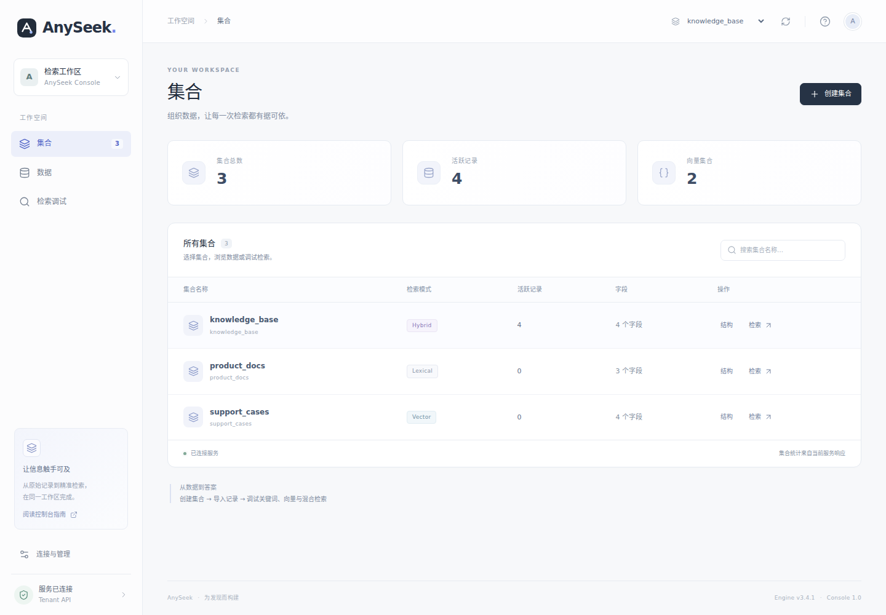
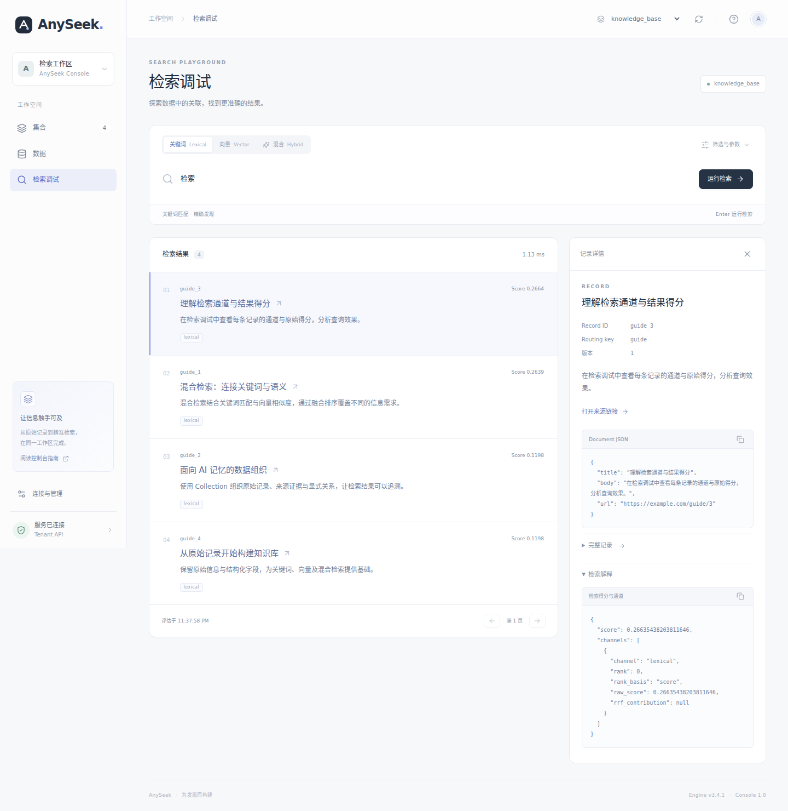

# AnySeek Console

独立的中文开发者控制台，使用 React、TypeScript 与 Vite。源码与构建产物位于 `console/`，不参与 Cargo 构建；Rust 服务只提供 HTTP API。

## 本地启动 UI

### 1. 启动 API

API 需要保持运行。完整的 Linux / macOS、Windows PowerShell 启动命令见仓库[快速开始](../README.md#快速开始)，Tenant 和普通 API Key 的签发流程见[服务指南](../anyseek/src/server/README.md#构建与启动)。

默认 API 地址为 `http://127.0.0.1:8080`，访问 `/api/v1/live` 应返回服务版本。**UI 的集合连接使用 Tenant API Key，不能使用 Master Key。**

### 2. 启动前端

安装 Node.js 24 和 npm，在第二个终端从仓库根执行。以下命令适用于 Linux / macOS 和 Windows PowerShell：

```sh
cd console
npm ci
npm run dev
```

API 已运行时只需执行本步骤。`npm ci` 用于首次安装或锁文件更新后同步依赖，日常启动运行 `npm run dev` 即可。

### 3. 打开界面

打开终端显示的地址，默认是 `http://127.0.0.1:5173`。已有 Tenant API Key 时，输入 Key 并点击“连接服务”。首次启动只有 Master Key 时，点击“首次使用？使用 Master Key 初始化”，填写新 Tenant 名称和 Master Key，确认创建并签发普通 Key。复制保存生成的普通 Key，再确认进入工作区，即可创建集合、导入 JSON 并调试检索。

初始化只复用现有 Tenant 与 Key 接口，Master Key 仅在内存中使用。初始化请求和生成的普通 Key 保留在当前标签页的 sessionStorage；失败、丢响应、返回或刷新后，从同一入口重试原请求，不生成新身份或密钥。刷新后需重新输入 Master Key。重试仅在当前或前一 UTC 日的 operation_id 有效期内；期间不要关闭标签页、清除会话或切换 API 服务。返回不会撤销 Tenant 或 Key。已有 Tenant 冲突不会当作成功，请使用管理员已签发的普通 Key 连接；本入口不管理已有 Tenant 的权限或密钥。

| 地址 | 用途 |
| --- | --- |
| `http://127.0.0.1:5173` | UI 页面，由 Vite 提供 |
| `http://127.0.0.1:8080/api/v1/live` | API 存活检查，返回服务版本 |
| `http://127.0.0.1:8080/` | API 根路径返回 404，不提供 UI |

端口被占用时，Vite 可能选择下一个端口，以终端输出为准。Ctrl-C 停止当前终端中的进程，API 和 UI 分别停止。

## 创建集合

填写集合名称、选择检索模式，通过字段表单增删字段、选择类型及全文检索、过滤排序和结果返回选项，无需编写 Schema JSON。预置 title、body、url 字段；向量或混合模式增加向量字段并设置维度，无需填写模型名称。文档与查询的向量需由调用方在同一向量空间生成。

## 浏览器端自动嵌入

选择含 Json 向量字段的集合，在“连接与管理 → 浏览器嵌入”填写完整的 OpenAI 兼容 embeddings API 地址（例如 `https://model.example.com/v1/embeddings`）、模型名称和可选模型 Key；勾选文本字段并选择目标向量字段。先测试连接，再保存本地配置。

- UI 直接向模型地址发送 `{model,input:[文本…],encoding_format:"float"}`，按响应 `data[].index` 对齐向量；验证数量、有限数值和集合维度。内核不调用模型、不保存模型地址和密钥，集合接口仅补充只读 `vector_dimensions`。
- 地址、模型名称和字段映射保存在当前控制台来源的 localStorage，按连接 Key 的指纹和集合隔离；不同 Key 不自动共享，即便属于同一 Tenant。切换浏览器或清理站点数据后需重新配置。同一控制台代理到另一服务时，请清除旧配置并重新连接。
- 模型 Key 默认仅在内存中；可选择在当前标签页 sessionStorage 中记住以跨刷新使用。切换或断开 AnySeek 连接时清除旧连接的模型 Key。提供“清除本地模型配置”，待处理导入仍保留原配置快照以便继续重试；模型 Key 从不进入 localStorage 或 AnySeek 请求。
- 普通 JSON 导入可启用“自动生成缺失的向量”。按所选顺序用换行拼接文本，已有目标向量保留并校验；不自动覆盖。Record envelope 继续发送原请求，不自动生成向量。
- 单条嵌入文本最多 30 KiB，每批最多 16 条，串行调用，单次超时 60 秒。模型自身的 token 限制仍需遵守。已生成的向量、原始数字文本和 operation ID 存入现有会话重试记录；中断后只生成缺失批次，再按请求大小通过 `/ingest` 分批提交。逐项处理 committed/rejected/outcome_unknown/not_attempted，即使 HTTP 非 2xx 也保留已确认回执。未知结果不能直接丢弃或换 ID 重写。
- 自动嵌入的写入成功表示已持久提交，索引异步推进；导入窗口显示提交、全文和向量进度，可手动刷新。向量/混合检索可输入自然语言自动生成查询向量，翻页复用同一个查询向量；仍可切换到手工输入。

浏览器会把所选文本和自然语言查询发送给配置的模型服务；模型服务必须允许当前控制台来源的 CORS（POST、Content-Type、Authorization）。HTTPS 控制台应连接 HTTPS 模型服务。浏览器无法绕过服务端 CORS；本功能不提供内核代理。模型请求不携带 AnySeek Key、Cookie 或 referrer，并拒绝重定向。模型名称和维度相同也不保证向量空间相同，变更模型后需自行重新生成已有数据向量。

本地配置不进入服务备份。关闭标签页、清除会话或 operation ID 过期可能影响未确认任务的重试，请先处理保留任务。首版不包含切片、浏览器本地模型、自动重试模型限流或多模型路由。

## 配置 API 地址

浏览器始终请求当前 UI 域名下的 `/api`，由前端服务器转发到 AnySeek。API 地址由启动前端服务器的环境配置决定，不在浏览器填写，不需要修改内核 CORS。

| 场景 | 配置项 | 默认值 | 生效时机 |
| --- | --- | --- | --- |
| `npm run dev` / `npm run preview` | `API_TARGET` | `http://127.0.0.1:8080` | 启动 Vite 时 |
| 前端 Docker 镜像 | `API_UPSTREAM` | `http://anyseek:8080` | 启动容器时 |
| 自行托管静态产物 | Web 服务器的 `/api/` 反向代理 | 由部署者配置 | 加载服务器配置时 |

填写 API 服务的基础地址，**不要追加 `/api` 或 `/api/v1`**。修改环境变量后重启对应前端进程。

例如 API 运行在 `http://127.0.0.1:9090`，在 `console/` 目录启动：

Linux / macOS：

```sh
API_TARGET=http://127.0.0.1:9090 npm run dev
```

Windows PowerShell：

```powershell
$env:API_TARGET = 'http://127.0.0.1:9090'
npm run dev
```

Windows CMD：

```bat
set API_TARGET=http://127.0.0.1:9090
npm run dev
```

`API_TARGET` 只供 Vite 代理使用，`npm run build` 不会把它变成生产 API 配置；生产需单独配置反向代理。

## 从其他电脑访问开发 UI

默认只监听 `127.0.0.1`。需要从其他电脑访问时，在 `console/` 目录运行：

```sh
npm run dev -- --host 0.0.0.0
```

浏览器访问 `http://前端主机IP:5173`，实际端口以终端为准。如果 API 也在该主机的 8080 端口，仍可使用默认代理；如果 API 在其他主机，按上一节设置 `API_TARGET`。这个地址应当能被**运行 UI 的主机**访问。

Vite 用于开发调试，生产使用下面的静态构建和 Web 服务器部署。

## 构建与部署

在 `console/` 目录运行：

```sh
npm ci
npm run build
```

将 `console/dist/` 部署到静态 Web 服务器，并把同源 `/api/` 代理到 AnySeek HTTP 服务，保留 `apikey` 请求头。前端与 API 可独立部署，但浏览器通过同一个对外入口访问。

仓库提供独立的前端镜像。从仓库根运行，将网络与 API 地址替换为实际配置：

```sh
docker build -f console/Dockerfile -t anyseek-console .
docker run --rm -p 8081:80 --network YOUR_NETWORK \
  -e API_UPSTREAM=http://YOUR_API_HOST:8080 anyseek-console
```

浏览器打开 `http://127.0.0.1:8081`。`API_UPSTREAM` 必须是前端容器能访问的 API 地址；容器内的 `127.0.0.1` 指向前端容器自身。该变量在启动时配置代理，不写入浏览器产物。生产对外入口配置 HTTPS。Nginx 配置见 [nginx.conf.template](nginx.conf.template)，仓库根 Dockerfile 仍只构建 API 镜像。

本地检查构建产物可运行 `npm run preview`，默认打开 `http://127.0.0.1:4173`，支持相同的 `API_TARGET`；预览服务器不用于生产。

## 常见启动问题

| 现象 | 检查与处理 |
| --- | --- |
| 打开 8080 根地址得到 404 | 这是 API 端口；打开 UI 终端显示的地址，默认 5173 |
| 页面能打开，连接请求失败 | 确认 API 已启动；检查 Vite 终端中的代理错误及 `API_TARGET`，不要追加 `/api/v1` |
| 提示 Key 无效或无权访问集合 | 使用管理员签发的 Tenant API Key；Master Key 只用于管理操作 |
| 别的电脑打不开 UI | 用 `--host 0.0.0.0` 启动开发服务器，并访问前端主机 IP |

## 使用

- **集合**：查看集合、记录数、检索模式与 Schema；创建 Lexical、Vector 或 Hybrid 集合。
- **数据**：游标分页、原始记录预览、精确 JSON 复制、文件或粘贴导入。Record envelope 支持条件更新、删除、向量补写。
- **检索调试**：关键词、外部向量及混合检索；日期、时间和高级参数；查看逐命中得分与通道。向量由调用方使用相同 embedding 模型生成。
- **高级检查**：实体目录、一跳关系、关系融合、来源证据。
- **连接与管理**：切换 Tenant Key；单独输入 Master Key 备份服务或恢复到新的停止状态目录，Master Key 不持久保存。

Tenant API Key 保存在当前标签页的 sessionStorage，Master Key 不保存。创建与写入在发送前保留原始请求，刷新或网络中断后可以重试；待确认请求绑定连接指纹与原集合。**断开连接保留待确认请求**，用原 Key 和原集合继续处理。结果未知时不提供丢弃入口，明确拒绝后可修改。逐条导入不提供批次原子性。

写入和重试保持输入数字 token；预览、复制及游标续页保持服务响应中的数字 token，避免 JavaScript 的 i64 精度损失。游标冲突时从第一页刷新。

## 验证

从仓库根先构建服务，再运行前端验证：

```sh
cargo build --features server --bin anyseek_server
cd console
npm ci
npm test
npm run build
npx playwright install chromium
npm run test:browser
```

浏览器测试会启动独立临时数据根的真实 API（127.0.0.1:18180）和 Vite（127.0.0.1:4173），不连接用户服务，也不使用配置中的 S3 bucket。请保持这两个端口空闲。可通过 `ANYSEEK_SERVER` 指定服务二进制绝对路径，通过 `CHROMIUM_PATH` 指定已安装的 Chromium。

测试覆盖内核静态路由清理、连接与集合创建、创建回包丢失、i64 导入/回包丢失/刷新重试/精确复制/条件编辑、三种真实检索、空态、高级入口及移动端。截图位于 `test-results/screenshots/`；失败时保留 trace。

首次初始化的隔离浏览器测试使用 mock API，不需要启动 Rust 服务：

```sh
npx playwright test --config playwright.bootstrap.config.ts
```

覆盖正常初始化、Tenant/Key 丢响应与刷新重试、连接失败重试、普通 Key 连接、取消返回、重复点击与 Tenant 冲突；不创建真实部署凭据。

## 界面

以下为临时测试数据下的实际界面。





## Markdown 文档导入

在集合的“数据 → 导入数据 → Markdown 文档”中选择 `.md` 或 `.markdown` 文件（UTF-8）。每批最多 20 个文件、合计 2 MiB，最多生成 500 个片段。

1. 选择正文目标字段（Text/String）；可选保存文档标题、来源文件名和片段序号（Int）。同一字段不能重复映射，不自动修改集合结构。
2. 检查分块预览，再点击“确认字段与分块预览”。正文会附带文档标题与章节路径。修改文件或映射后需要重新确认。
3. 向量集合需先配置浏览器嵌入服务，并将正文目标字段加入“嵌入文本字段”；文档内容会发往该模型地址。纯全文集合无需模型。
4. 点击“写入集合”。每个片段新增一条记录，通过 ingest 分批提交，索引异步更新；失败后使用保留任务重试，复用原始标识和已生成向量。

分块识别 ATX 标题（`#` 至 `######`）和空行段落，目标约 4,000 字符。围栏代码、连续列表和表格不强行截断，超长块会提示；字符目标不是模型 token 上限。当前不做完整 Markdown 语法解析，不下载链接或图片，预览按纯文本显示，不执行 HTML。原文件不单独上传保存。

首次导入仅支持追加：重新选择并导入同一文件会新增记录，不自动覆盖或删除旧片段。批次不保证原子性，已提交片段不会因后续失败回滚。

## 查询向量预览

在“检索调试”中选择向量或混合模式，启用“自动生成查询向量”后，输入文本并点击“生成并预览向量”。此操作只调用浏览器配置的嵌入模型，不发送检索请求；预览显示完整向量及维度，支持复制。

随后“运行检索”复用已生成的向量，分页继续复用原始查询。修改查询文本后旧预览失效，需要重新生成；也可直接运行检索，生成的向量同样会显示。预览仅保留在当前页面内存中。

## 删除集合

在集合列表点击“删除”，输入完整集合名称后确认。删除后集合及记录无法继续访问，界面不支持撤销；底层文件由服务后续回收。存在待确认写入时，先在数据导入界面处理原任务。

控制台会保留删除请求标识。网络中断或刷新后，从集合列表的待确认删除提示继续处理，复用原请求；删除确认后清理该集合的浏览器嵌入配置与密钥。

## 检索打分展示

结果卡片显示最终得分和各通道原始分数。点击结果，在“检索打分”表格中查看原始分数、通道内排名、排序依据和 RRF 融合贡献；原始解释 JSON 收起保留。

通道排名从第 1 名展示，仅对应本次候选范围。关键词分和向量分尺度不同，不可直接比较，不代表置信度；融合分是 RRF 贡献之和。未返回的通道标为“未进入候选或未启用”，不伪造零分。界面分数保留 7 位有效数字，原始 JSON 保留服务返回值。

## 界面语言

默认使用中文，可在页面右上角唯一的语言图标切换到 English。语言偏好保存在当前浏览器的 `anyseek.language`，刷新后恢复；浏览器禁用存储时仍可切换。切换不会刷新页面或清空表单、连接、待确认请求。

导航、表单、提示与打分详情同步切换；字段名、记录原文与 API JSON 保持原样，未知服务端错误保留原文。标签页标题随语言显示为「AnySeek · 语义空间」或「AnySeek · Semantic Space」。

新增界面文案使用 `t("中文文案")`，在 `src/messages.ts` 补充英文翻译；动态内容使用 `{0}` 等占位符。运行 `npm test` 检查字典与占位符，运行 `npx playwright test --config playwright.bootstrap.config.ts` 验证语言切换和连接流程。
