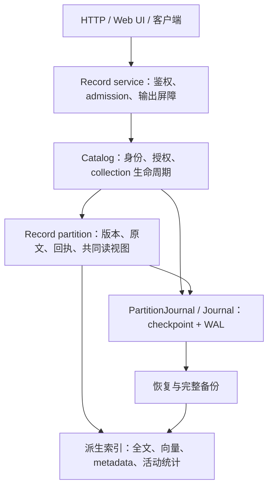

# P1 可靠记录引擎实现

本文说明 [Issue #57](https://github.com/TheLudlows/seekpower/issues/57) 的 P1 当前实现、关键约束和验收边界。当前代码完成了 **P1-A 的有界功能闭环**：默认 HTTP/Web UI 已接入 Record/catalog，成功写入同时满足持久化和可见性。**P1 整体验收尚未完成，Linux/Windows 的系统崩溃与断电矩阵仍未运行。**

实现基线为 `fc4fcfe64fdf86d03c07f82cf1d4889deb896801`，开发分支为 `feat/57-reliable-record-engine`，对应 [PR #61](https://github.com/TheLudlows/seekpower/pull/61)。复用基线已有的 Weighted RRF、canonical scoring order、固定 XXH64 和索引格式 8；PR #60 不在基线中。

本文按当前设计组织，阶段性尝试、旧测试总数和修复过程保留在 Git 历史。HTTP 使用方法见[服务 README](../seekpower_server/README.md)，完整路由见[功能清单](../FEATURES.md)，机器可读验证信息见[验收记录](validation/issue57-p1-checkpoint.json)。

P2 后续设计与当前实施记录见 [P2 实施设计](implementation-57-p2.md)。P2 来源/证据基础删除切片已在本地接入默认服务，详见实施设计第 12 节；新增同服务受控接管见第 13 节；独立灾难恢复激活与完整 P2 仍未完成。四项业务策略已确认；来源修订/stale 后续本地批次及其独立验证见第 14 节，generation 的可选向量依赖切片见第 15 节；generation staging/publish 实施见第 16 节；TTL/time 本地功能闭环及分平台验证见第 17 节；持久 feed 的本地实施与验证见第 18 节；实体/显式一跳关系及 P2 真实缺口清单见第 19 节。PR #61 已合并至 `64b1c8f656394a55f5b8a1239754d03d2872efd5`，此后本地 P2 分支的验证单独记录，不覆盖下面 P1 历史证据。

## 导航

- [1. 目标与完成范围](#1-目标与完成范围)
- [2. 架构与权威数据](#2-架构与权威数据)
- [3. 稳定身份、条件写入和重试](#3-稳定身份条件写入和重试)
- [4. 写入发布与共同读视图](#4-写入发布与共同读视图)
- [5. WAL、检查点与恢复](#5-wal检查点与恢复)
- [6. 共享授权与撤销](#6-共享授权与撤销)
- [7. 服务、客户端与生命周期](#7-服务客户端与生命周期)
- [8. 备份与恢复](#8-备份与恢复)
- [9. 资源边界与设计取舍](#9-资源边界与设计取舍)
- [10. 验证方法与结果](#10-验证方法与结果)
- [11. P1 剩余验收与后续阶段](#11-p1-剩余验收与后续阶段)

## 1. 目标与完成范围

P1 的目标是在现有检索内核上建立可靠记录引擎：已确认写入在支持的故障模型下可恢复，检索不会混合不同记录版本，错误不会伪装成成功。首版每个 collection 使用一个持久 partition 和一个内部搜索 shard；可创建多个 collection，但不提供跨 collection 事务或全局序列。

| 能力 | 当前实现 | 验收状态 |
| --- | --- | --- |
| 稳定身份与条件写入 | record_id、固定 routing_key、版本、删除墓碑、防 ABA | 原生进程与 HTTP 回归已通过 |
| 幂等与错误分类 | 原 operation_id 重试、独立回执、明确未知和待恢复结果 | 响应丢失与重启回归已通过 |
| 可靠提交与恢复 | WAL、冗余见证、完整 checkpoint、在线代切换 | Linux/Windows 原生进程验证已通过；主机断电未验收 |
| 共同读视图 | 原始记录、活动版本、全文/向量/过滤、统计在同一发布位置读取 | 增量状态与有效记录重建对照已通过 |
| 共享授权 | key 与数据独立、共享 grants、提交和输出撤销屏障 | 交错、取消、重启及真实 HTTP 验证已通过 |
| 服务闭环 | 默认 HTTP/UI、遍历、删除计划、非原子 batch、完整备份恢复 | HTTP/Chromium 与故障注入已通过 |
| 资源边界 | 明确容量、队列、请求期限和候选上限 | 边界回归已通过；不承诺持续无限运行 |

表内历史双平台结果与本次修复的本地结果分别列于第 10 节，不能互相替代。P2 的来源/generation/证据与可选向量、P3 的长期压缩回收不计入已完成能力。普通 Document 中保存同名属性，也不代表引擎已经实现这些语义。

## 2. 架构与权威数据



| 模块 | 职责 |
| --- | --- |
| [record.rs](../seekpower/src/record.rs) | 权威 Record 状态、操作账本、条件写入、增量发布、查询/遍历/统计 |
| [catalog.rs](../seekpower/src/catalog.rs) | key verifier、collection 状态、grant revision、控制回执、授权屏障 |
| [catalog/service_snapshot.rs](../seekpower/src/catalog/service_snapshot.rs) | 完整 service/catalog 快照及新根恢复 |
| [storage/journal.rs](../seekpower/src/storage/journal.rs) | 有校验和与序列的 WAL、持久提交见证、恢复和 writer lock |
| [storage/partition.rs](../seekpower/src/storage/partition.rs) | 持续 owner lock、完整 checkpoint、代发布和退役 |
| [storage/platform.rs](../seekpower/src/storage/platform.rs) | Linux/Windows 文件同步、同卷目录发布与清理 |
| [active.rs](../seekpower/src/active.rs) | 活动文档 N、term df、字段长度及其增量维护 |
| [search.rs](../seekpower/src/search.rs)、[vector.rs](../seekpower/src/vector.rs)、[min_heap.rs](../seekpower/src/min_heap.rs) | 候选检索、旧版本排除、逻辑 ID 平分排序、融合 |
| [record_service.rs](../seekpower_server/src/record_service.rs) | 默认 HTTP 契约、请求/控制 admission、授权输出、OpenAPI |
| [Web UI](../seekpower_server/web/js)、[客户端与回归脚本](../scripts) | 保存原请求、重试、搜索和服务生命周期操作 |

权威状态保存完整原始 Document、未经归一化的输入向量、配置、稳定身份、版本、墓碑、序列和操作结果。`schema.store` 控制搜索字段投影，不决定原始数据是否持久保存。

倒排、向量索引、metadata 和搜索 docstore 是可重建派生数据。现有 `index.bin`、`vector.bin`、`docstore.bin` 等可变文件不承担多文件原子提交；恢复从权威状态重建它们。低层 `Commit::commit` / `Close::close` 已返回 I/O `Result`，但直接调用低层索引 API 不自动获得 Record 服务的可靠性契约。

## 3. 稳定身份、条件写入和重试

### Record 契约

`collection_id` 与 `record_id` 是字符串业务身份；内部 DocID 仅是索引地址。RecordWrite 包含：

| 字段 | 语义 |
| --- | --- |
| `operation_id: {epoch, nonce}` | 一次逻辑操作的重试身份；发送前保存 |
| `record_id` | collection 内唯一记录身份 |
| `routing_key` | 首次创建后固定；删除再创建也不能静默改变 |
| `expected` | `"Absent"`、`{"Match": version}` 或 `"Any"` |
| `document` | 必须显式提供；对象为完整替换，`null` 为删除 |

记录版本与 partition 序列分开：版本标识同一记录的修订，序列标识 partition 内发布顺序。删除保留版本墓碑，重建继续递增版本，旧 `Match` 不会因身份复用而接受新内容。`Absent` 表示当前没有活动记录；`Any` 不检查版本，但仍检查身份、routing key 和其他约束。

### 幂等窗口

操作 epoch 为自 Unix epoch 起的 UTC 日数。引擎接受当前日和前一日，正常当日签发至少有 24 小时重试窗口，并持久保存已观察 epoch 水位，避免时钟回退复活过期请求。外部控制请求不能使用保留的 `sys:` nonce 命名空间。

同一 operation_id 和相同完整语义请求返回原回执，不推进版本或序列；同一 ID 更换内容返回冲突。Record 操作比较完整语义请求，不依赖有碰撞风险的短摘要判等。操作查询缺席、超时或过期都不证明此前未执行；客户端不能据此换 ID 补写。当前 Record checkpoint 保留账本，尚无持续账本 GC。

### 错误与重试行为

| 结果 | HTTP | 保证及调用方动作 |
| --- | --- | --- |
| 成功 | 200 | 写入已持久且可见；返回原操作身份、回执与过期时间 |
| `rejected` | 400 | 本次校验或容量拒绝；不能解除更早请求的未知状态 |
| `conflict` | 409 | 版本、routing key 或操作内容冲突；同样不证明早先未知请求未执行 |
| `busy` | 429 | admission 拒绝，可能发生在回执查询之前；保留原请求重试 |
| `operation_expired` | 410 | 超出支持窗口；不能生成新身份猜测性补写 |
| `outcome_unknown` | 503 | 持久化或请求结果不确定；保留原请求，通过恢复和查账判定 |
| `durable_pending` | 503 | 权威操作已持久，派生应用未完成；实例需恢复 |
| `recovery_required` | 503 | 实例已封锁，不能继续提供可信读写 |
| `storage_error` | 503 | 存储失败；不把失败转换成成功或空数据库 |

这张表描述结果分类，不承诺所有失败都发生在回执查询之后。尤其是一次响应丢失后，再次收到拒绝、冲突或繁忙，只描述本次尝试，不能推翻先前可能已经提交的事实。

## 4. 写入发布与共同读视图

### 写入流程

1. 获取 admission；由独立持有所有权的任务接管操作。HTTP 取消或超时不会取消已接管的持久工作。
2. 在 partition 锁内检查健康状态、epoch、身份和请求结构；查找相同 operation_id 的原结果。
3. 校验版本条件、routing key、向量、记录/账本/WAL 预算，以及写入后能否生成完整 checkpoint。
4. 追加权威操作并同步 WAL 与见证。进入此阶段后的不确定错误封锁实例，不能继续以旧视图服务。
5. 增量写入新的物理索引版本，撤销旧活动版本和统计，更新原始记录及身份映射。
6. 在同一锁内发布逻辑序列、活动统计和操作回执，恢复健康状态后返回成功。

正常写入只更新受影响的记录、账本索引和 checkpoint 字节计数，不逐写重建全库，也不每次克隆/序列化完整状态。完整快照与启动重建仍按保留状态规模执行。WAL 持久后，任一派生应用失败都返回 `durable_pending` 并阻止部分视图泄漏；恢复重放已持久操作后才能继续。

### 读视图、统计与排序

Record partition 的锁覆盖候选检索、版本映射、权威原文回表和统计读取。一次查询对应同一个 `visible_seq`；实时和已提交索引、向量、过滤、原文及统计不能来自不同发布位置。它是受锁保护的当前视图，不是供调用方无限持有的历史 MVCC 快照。

活动 N、term df 和字段长度与物理 posting/编码计数分离。替换和删除移除旧版本贡献，实时、已提交、N-gram 和归一化路径读取共同活动统计；剪枝上界采取保守策略，不能只修正最终分数。

稳定逻辑 record_id 在词法候选堆、向量选择和融合中参与平分排序，早于候选截断。旧版本在候选选择中排除，不能占满 Top-K 后才过滤。物理 DocID 的先后顺序不能替代业务 ID 顺序。

空查询直接使用现有迭代候选逻辑，保留删除检查、metadata 过滤、字段排序和稳定 ID 排序。因此没有词法字段的纯向量 collection 也可用 `{}` 浏览，并支持分页和 `length:0` 计数。这个分支位于词法字段/segment 提前返回之前，不依赖旧服务的浏览捷径。

Vector/Hybrid 继续受 ANN 探测和 RRF 候选窗口约束；窗口内计数不声称全库精确并集，窗口内字段重排不保证全库字段 Top-K。搜索字段投影遵循 `schema.store` 和请求 `fields`；按 ID 读取与 iterator 可以访问完整权威原文。

## 5. WAL、检查点与恢复

### Journal 提交见证

WAL 帧带长度、校验和与顺序约束。日志同步后，在三个独立见证文件中逐个更新最旧的两份并同步；成功需要两份持久见证。恢复选择最高有效位置，验证其完整日志范围，再修复冗余后接受新写入。见证范围外的尾部不视为已提交数据；认证范围内损坏必须报错。

单个见证撕裂不能丢弃已确认提交；两个无效见证或不一致位置失败关闭。恢复先修复无效见证，不先覆盖较旧的有效副本。这个协议假设写一个见证文件不会损坏另一文件，不能从进程测试直接推导主机掉电保证。writer lock 防止遵守协议的并发写者，不防止外部任意修改文件。

### 完整 checkpoint 与在线代切换

完整 checkpoint 包含配置、当前记录、版本墓碑、序列、epoch 水位及操作账本。`compact_journal()` 保留当前服务索引，执行：

1. 在唯一准备目录写完整新代，完成快照、WAL 与见证同步。
2. 持久发布代目录；只有发布成功后，才写入同样受见证保护的 `PUBLISHED` 证书。
3. 切换当前 journal，关闭旧句柄；持久退役旧代后回收其文件。

仅看到新目录不代表发布完成。恢复选择最高已认证代；已认证新代损坏不会静默回退旧代。未认证、可证明尚未服务写入的准备状态才允许清理。首次根发布也必须完成认证；中断初始化由严格恢复流程继续，不能把不完整目录重置为空数据库。

owner lock 跨越完整代生命周期及创建返回。未完成清理必须先成功，才能分配下一代，避免失败重试无限积累目录。清理准备项和遗留 trash 时再次完成持久重命名屏障，防止之前 rename 成功、父目录同步失败后直接删除内容。恢复使用更大读预算也不能扩大已持久保存的写入预算。

### 启动与平台适配

服务启动先取得外部根锁，恢复 catalog 与已登记 partitions，再提供请求。只清理当前根拥有的不可寻址准备目录和派生缓存，不扫描/删除其他服务根。异步恢复或 hybrid 查询的调用者取消后，相关任务必须释放 mmap 和索引句柄，才能释放允许另一恢复过程接管的锁。

Linux 同步文件和准备目录，同父目录 rename 后同步父目录。Windows 使用同卷、无覆盖的 `MoveFileExW(MOVEFILE_WRITE_THROUGH)`，移动前关闭内部 journal、owner 和 mmap 句柄；路径通过已有父目录 canonicalize 加目标 leaf 构造扩展长度绝对路径，覆盖深路径、UNC 和相对根。文件同步错误和短写错误向上传播，提交失败仍等待所有 shard 任务结束。

这是当前本地文件系统实现，不是对象存储 root/CAS 协议，也不是旧索引格式迁移工具。

## 6. 共享授权与撤销

catalog 独立保存 key 身份、verifier、collection 生命周期和 grant revision，不保存调用方原始 API key。数据不归单个 key 目录所有；多个 key 可共享 collection，撤销其中一个不会删除数据或影响其他有效授权。master 管理身份和 grants；普通 key 可创建 collection 并访问已授权数据，首版不细分读写角色。

创建采用持久 `Prepare → 初始化 Record partition → Activate`。初始化期间创建者被撤销，不会通过 Activate 恢复旧授权，也不能复用创建身份。删除 collection 是独立 master 操作：持久墓碑、撤销 grants、拒绝身份复用，物理回收后置。

当前 catalog 全局 mutex 覆盖完整授权工作，确定写入提交与撤销的先后。任务取消不提前释放发布屏障；授权任务 panic 或撤销持久化不确定会封锁授权状态。容量不足导致撤销失败时，不返回撤销成功，也不能继续把可能不安全的旧授权当作正常状态使用。

响应持有带身份和 grant revision 的 `OutputPermit`，最终状态/头交付和 body frame 交付均复核。成功响应、冲突及序列化/超预算错误共用屏障；revoke 后重新 grant 不能使旧 permit 复活。已经交给传输层的字节无法收回。

该设计用串行屏障简化正确性，代价是不同 collection 的完整读写也会相互等待；尚未实现 collection 间公平调度或更细粒度并发隔离。

## 7. 服务、客户端与生命周期

默认启动挂载 `record_service.rs`，实际 OpenAPI 为 19 个 path、25 个 operation。旧 `http_server.rs`、`keys.rs`、`operations.rs` 尚在源码中，但未挂载，不提供旧按 key 目录或数字 DocID HTTP 协议的兼容入口。服务只接受新的可恢复根或尚不存在的初始路径，不导入旧服务目录。

| 操作 | 实现语义 |
| --- | --- |
| 写入/替换/删除 | 完整 RecordWrite；成功即 durable + visible |
| PATCH collection | 在线完整 checkpoint，不是写入成功后的第二次确认 |
| iterator | 稳定 ID 正向分页；cursor 绑定 visible_seq，写入后旧 cursor 返回 409 |
| delete-plan | all/ids/词法 query 选取目标及精确版本；客户端保存计划并分配每项原 operation_id |
| batch | 1..100 个独立操作，逐项结果，非原子；不确定/待恢复错误停止未尝试尾部 |
| collection 删除 | master 持久删除身份、撤销访问；不立即删除仍可能被映射的数据 |

Web UI 在发送前把原请求保存在 sessionStorage。写入还在发送前保存“未确认”状态：丢响应或刷新后，后续 `rejected`、`conflict`、`busy` 不会解锁丢弃或重新分配身份；收到成功回执后才推进已完成位置。没有经历未知结果的明确写入拒绝，可以释放被拒绝及未发送的余项。创建只在明确的 `creation_rejected` 时释放请求。

Python 客户端要求调用者提供完整请求，不在重试中分配身份。小型 smoke 先保存请求文件，再发送；复用同一文件会重放同一逻辑操作。旧 `http_smoke.py` 已删除，由 `record_service_smoke.py` 覆盖默认服务；README、REST 示例和 OpenAPI 使用同一当前协议。

## 8. 备份与恢复

### Collection 快照

独立快照包含 Record 配置、原文/向量、版本墓碑与回执。同一 backup operation_id 重试保留原快照，不因来源后来改变而重新取点。master 恢复到新 collection 身份，不恢复历史 grants。

备份退役先持久记录身份墓碑，再删除文件。未完成 restore 会 pin 来源；已完成 restore 的重试不再依赖来源仍存在。备份 ID 仅接受规范小写 hex，防止 Windows 大小写别名绕过 pin/退役判断。物理清理未完成返回 `cleanup_pending`，不能宣称文件已删除。

### 完整 service/catalog 快照

完整备份在 catalog 屏障下冻结一致切面，包含完整 catalog、所有保留 collection（含逻辑删除者）及未退役 collection backups。已删除且从未激活、确无物理数据的 intent 显式记为缺席；已激活数据缺失则报错。旧 service archives、派生缓存和准备垃圾不递归纳入。

manifest 记录协议版本、请求派生身份、catalog 与各 partition 水位、缺席身份和权威 payload 的 SHA-256。子对象及 manifest 在私有 staging 完成认证，释放句柄后发布外层目录，再写独立完成见证。仅看到外层目录不等于成功；未认证完成见证可以按严格初始化流程修复，已认证内容损坏则失败关闭。

完整恢复只发布到新的、尚未启动的 sibling root，不覆盖或切换运行服务。历史非 master key 禁用、历史 grants 清空，只授予当前可信 master 初始访问；历史 catalog 保留为审计材料。历史控制操作 ID 显式冲突，Record 数据版本和回执保留。共享访问需创建新 key 身份并重新授权。

目标根正常运行或写入之后，原恢复请求重试只核对不可变完成记录和来源身份，返回原结果，绝不再次覆盖目标。普通启动拒绝直接服务 archive 或未认证恢复根。UI 返回新根位置，不自动启动或部署它。

## 9. 资源边界与设计取舍

| 边界 | 当前值或行为 |
| --- | --- |
| Record 身份、累计保留操作、候选 | 各 10,000；身份包含墓碑，checkpoint 不释放数据操作额度 |
| 单操作 / HTTP body / 响应 | 1 MiB / 2 MiB / 16 MiB |
| Record WAL 代 / 完整 checkpoint 单帧 | 256 MiB / 16 MiB；每次写前检查完整可恢复状态能否容纳 |
| catalog | 16 MiB 代、10,000 操作；安全回收过期控制回执并保留 epoch 水位 |
| 服务请求 / 控制任务 / partition admission | 64 / 16 / 8；饱和返回 busy |
| 请求期限 | 30 秒；超时可返回 outcome_unknown，不取消已接管写入 |
| collection backups | 32 个；支持持久退役 |
| service archives / 生成恢复根 | 每源根 4 个 archive/准备项，每托管父目录 4 个生成根 |
| 完整备份预检 | 权威 payload 1 GiB，加每对象开销预留 |

请求 admission 持续到 body 消费或断开，避免仅生成响应就释放额度。达到容量边界显式拒绝，不静默淘汰回执或备份。Service archives 和生成根由明确的离线操作回收，没有删除运行根的接口。

当前用有限状态和背压保证实现边界；这不是容量或吞吐承诺。checkpoint 回收旧 WAL 代，不等于 Record 操作账本 GC 或物理索引历史压缩。全局 catalog 锁、完整快照大小、累计操作上限和启动全量重建都是已知限制。

## 10. 验证方法与结果

### 验证证据

| 源码范围 | 环境 | 实际结果 |
| --- | --- | --- |
| 修复前 PR head `9cb4be40b5e5b3cbca63a438f49df8482c90cbdb` | Linux CI / ext4 | [CI 39545934556](https://github.com/TheLudlows/seekpower/actions/runs/39545934556)：构建、Chromium、完整测试及原生持久化/HTTP 故障通过；完整套件 163 passed、0 failed、10 ignored |
| 同一修复前 head | Windows Server 2025 / NTFS | 同一 CI 的原生持久化、Record/catalog、输出屏障、HTTP 和进程故障任务通过；包含深路径和相对根 fixture |
| 本文所在修复提交，基于上述 head | 本地 Linux / overlayfs，2026-10-21 | 完整 workspace：35 suites，166 passed、0 failed、10 ignored；默认构建、HTTP/Chromium、fault-injection HTTP、独立核心边界、OpenAPI 生成通过 |
| 本次修复的远端 Linux/Windows | PR 工作流 | 尚待本次提交的 CI 验证；不能用上行旧 head 的结果替代 |
| 任一版本的系统/文件系统崩溃、断电 | Linux / Windows | 未运行 |

本地第一次完整测试因沙箱禁止绑定 TCP 端口而失败；启用测试所需本地网络权限后重跑完整套件，得到上述通过结果。10 个 ignored 中，9 个是由父测试显式启动的子进程 worker，1 个是需要额外环境参数的既有跨构建 fixture；不把它们单独算作已通过测试。

本次新增回归覆盖纯向量空查询的活动 ID、替换/删除、排序、过滤、分页、只计数、checkpoint 与恢复；也覆盖“已成功写入后的忙拒绝”仍可获得原回执，以及 UI 在真实写成功但响应丢失后，连续拒绝/冲突/繁忙和刷新仍保留原身份。迁移后的 Python 客户端在真实 HTTP 套件内执行两次同一请求文件，验证幂等。

### 可复现命令

```sh
cargo build --workspace
SEEKPOWER_TEST_ROOT=/path/on/test/filesystem cargo test --workspace --all-targets
python3 scripts/check_core_boundary.py
python3 scripts/record_service_smoke.py --server target/debug/seekpower_server --browser
cargo build -p seekpower_server --features fault-injection
python3 scripts/record_service_smoke.py --server target/debug/seekpower_server --faults
target/debug/seekpower_server generate_openapi=true
```

Windows 使用 `.exe`；Chromium 需要 Python Playwright 和浏览器运行时。`SEEKPOWER_TEST_ROOT` 应位于待验证的实际文件系统。故障注入只在显式 feature 构建启用，不通过公开 HTTP 打开。

核心测试入口为 `journal_`、`partition_`、`commit_io_tests`、`record::tests`、`catalog_`；服务屏障入口为 `record_service::tests`。工作流定义见 [ci.yml](../.github/workflows/ci.yml)。

| 必须维持的性质 | 主要回归位置 |
| --- | --- |
| WAL 见证撕裂、损坏、锁、恢复修复中断 | journal / partition 单元与子进程测试 |
| 已持久未发布封锁、版本 ABA、响应丢失、原始数据保留 | record 测试及真实 HTTP fault matrix |
| 增量统计、稳定排序、物理块边界和取消任务生命周期 | record 测试、既有 search/vector 集成测试 |
| 共享授权、撤销与提交/输出交错、重启后授权 | catalog / record_service 测试 |
| 创建、遍历、非原子删除、备份退役、新根恢复 | record_service_smoke.py |
| 请求身份保留、未知重试、词法/向量/混合 UI | record_service_browser.py |
| 核心无 HTTP DTO/schema 和终端依赖 | check_core_boundary.py，默认及 no-default-features |

## 11. P1 剩余验收与后续阶段

P1 尚缺的可靠性证据是 Linux 和 Windows 的真实系统/文件系统崩溃与断电矩阵。需要隔离 VM 或机器、可丢弃文件系统磁盘、外部强制 reset/power-cut 能力，以及故障域之外记录已确认写入和撤销的见证。重启后必须核对已确认数据、授权撤销、未知操作、恢复错误与继续服务能力。进程 kill/exit、注入 I/O 失败和调用 fsync 不能代替这一验收。

验收结论还必须限定于本实现的容量、调度和恢复边界；当前没有证明跨 collection 公平调度、长期稳定磁盘占用或任意规模下的恢复时间。放宽这些边界需要实现和相应验证，不能只修改文档数值。

| 后续阶段 | 不属于当前已实现能力 |
| --- | --- |
| P2 | 类型化 source/evidence、直接及间接来源隐藏、document generation、可选向量、时间/实体/关系、TTL/change feed |
| P3 | 不可变多索引段、跨段统计上下文、读者保护、持续压缩与安全回收 |
| P4–P6 | 对象存储权威协议、集群接管与公平性、跨 partition 查询、split/merge 与自动调度 |

P1 文档维护当前可靠记录契约和验收事实；不会因为这些后续目标写入规划，就把 P1-A、全部 P1 或整个 #57 标为完成。
