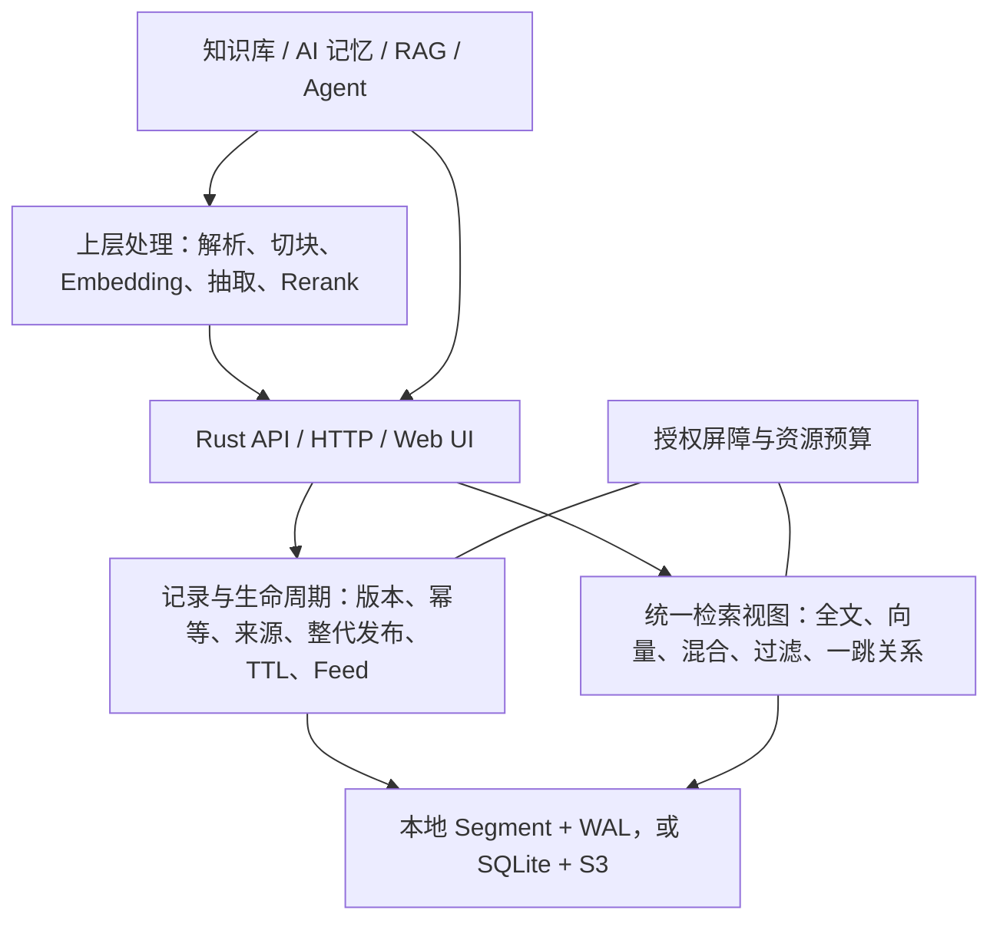

# 项目全貌与下一步建议

核验日期：2026-10-23。代码基线：master `3893cd54f0d8d47b6b9e35fa3cce34e579117764`。本文记录该基线的能力、限制和优先级建议；后续完成度以 [STATUS](../STATUS.md) 和对应 PR/CI 为准，建议不等于已经批准或实现。

## 定位与总体判断

anyseek 是面向 AI 记忆与知识的文档存储、检索底座，提供 Rust 核心库、HTTP API 和内嵌 Web UI。已经具备数据库主体能力：可靠记录、统一检索视图、生命周期、共享授权、持久化和恢复。当前最需要补齐的是长期运行、容量管理和运维验证。

应用负责文档解析、切块、Embedding、事实抽取、实体消歧、Rerank、模型推理和记忆归纳；anyseek 保存和检索准备好的记录、向量、来源及显式关系。不引入 SQL/JOIN、完整图查询语言或账户平台。

## 已实现的主体能力

| 层面 | 当前能力 | 使用边界 |
| --- | --- | --- |
| 检索 | BM25F 全文、IVF ANN、RRF 混合、多字段、中文、过滤、排序、分页、投影及逐命中解释 | ANN、有界融合及候选内字段重排不保证全库精确 Top-K |
| 可靠记录 | 稳定 ID、条件版本、墓碑、防 ABA、操作幂等和回执查询 | batch 为独立操作，不提供跨记录或跨 collection 原子事务 |
| 来源与证据 | 精确来源版本、字符/页码定位、直接和间接依赖、stale 与级联隐藏 | 来源和关系限定在同 collection；删除隐藏不依赖异步 Feed |
| 整文发布 | 多批私有 staging、租约、完整清单 Seal、整代 Publish 与清理 | staging 回执只证明持久，Publish 后成员才开放 |
| 向量后补 | 正文先可见，向量按精确版本后补 | 缺向量不参与该字段向量召回，不填零向量 |
| 时间与同步 | 固定 evaluation_time、时间过滤、不可逆 TTL、至少七天 Feed、bootstrap | 过期游标要求重建；容量不足背压，不丢弃窗口内事件 |
| 实体关系 | 显式实体目录、有预算的一跳邻居及关系通道融合 | 不自动抽取或推断关系，不提供完整图语言 |
| 共享授权 | 多 API key 共享 collection、grant revision、撤权及未交付输出复核 | 已发送字节无法撤回；整 key 撤销等操作仍有全局排空 |
| 持久化 | 本地 WAL/发布见证/Segment，或 SQLite 协调与 S3 不可变对象 | 真实 S3 合同和系统断电尚未验收 |
| 备份恢复 | collection 快照、完整服务归档、独立恢复、受控接管和安全对象 GC | 独立备份不能证明备份后没有删除；恢复不复活历史 grants |
| 服务资源 | 后台索引、校验缓存、collection 准入、控制预留及分级并发/字节/I/O 预算 | 保守准入与显式缓冲约束，不是全进程 RSS、系统带宽或全磁盘硬上限 |
| 接入 | Rust 库、HTTP、OpenAPI、Web UI、Python 工具及故障验收脚本 | UI 未覆盖全部管理操作，准确契约见服务指南 |

完整能力清单见 [FEATURES](../FEATURES.md)，请求示例和默认限制见[服务指南](../anyseek/server/README.md)。

## 存储与计算架构

默认服务为单机、多 collection；每个 collection 一个持久 partition、一个内部检索 shard。低层索引库的本机多 shard API 不代表服务支持分布式分片。

两种持久化模式共用 Record 语义、规范原始 Payload、不可变 Segment 和可变 tail。查询固定同一个发布位置、活动统计和 evaluation_time，在 Top-K 前排除旧版本及不可见记录，之后回表并检查输出许可。

| 模式 | 提交权威 | 内容存储与检索 | 恢复依据 |
| --- | --- | --- | --- |
| 本地 | 本地 PartitionJournal 的认证发布与提交见证 | 持久盘保存原始 Payload、Segment、检查点和 WAL；本机执行查询 | 认证检查点与完整已提交 tail；损坏时不静默回退旧状态 |
| S3 | 本地持久 SQLite，唯一选择 head、manifest 和提交/索引水位 | S3 保存不可变日志和文件块；本机缓存、物化 Segment 并执行查询 | SQLite 所选检查点及完整 tail，所有对象验证长度和 hash |

S3 写入先登记上传身份，再上传、远端读回校验，最后 SQLite 条件发布。上传成功本身不代表提交。SQLite 发布结果未知或发布后本地视图失败时保持输出封锁，恢复后以原 operation_id 查询或重试。

S3 模式必须保留服务 catalog、SQLite 权威库及其 WAL、`s3-namespace`；collection 内日志、Payload、索引和 `*.object-cache` 是可重建缓存。不能仅保留 bucket 或在运行中直接复制 SQLite 文件来代替共同备份。

后台 Indexer 已支持固定已提交 cut、屏障外构建、条件发布及保留期间新增 tail。当前仍是固定 cut 全量构建，自动增量调度未实现。协议细节见[存储文档](storage.md)。

## 主干与验证状态

| 阶段 | 状态 |
| --- | --- |
| P1/P2 | 可靠记录、来源证据、generation、TTL、Feed、显式关系及授权语义已合入 |
| A / PR #71 | 本地不可变 Segment、共同视图、flush、compaction 和安全回收已合入 |
| B / PR #72–#74 | SQLite/S3 提交、远端检查点、保留、GC、共同备份恢复与维护修复已合入；外部验收仍开放 |
| C1 / PR #75 | 有界后台 Indexer 已合入 |
| C2 / PR #76 | 每 authority 的校验对象缓存已合入 |
| C3-1 / PR #77 | collection 授权执行屏障与短元数据锁已合入 |
| C3-2 / PR #78 | collection 公平准入、控制预留、分级资源预算已合入为 `3893cd54` |
| C3 后续 | 服务总缓存额度与完整资源隔离验收未完成 |
| D | 超大 collection 的服务分片与可恢复 split/merge 未实现，按实际容量后置 |

[PR #78](https://github.com/TheLudlows/anyseek/pull/78) 最终源码的[五项 CI](https://github.com/TheLudlows/anyseek/actions/runs/39927824162) 全部通过：完整 Rust 34 suites / 317 passed / 0 failed / 13 ignored，包含 Ubuntu/Windows 原生持久化、S3 fixture 合同与无缓存语义、HTTP 故障矩阵，以及 10 组 Chromium 检查。ignored 包含由父测试调用的进程 worker 等，不冒称全部直接运行。

合入提交与最终测试版本的 Git tree 相同：`464c82153c3eb9e57630a5133fe34f8a22cec2d4`；[主干 CI](https://github.com/TheLudlows/anyseek/actions/runs/39933449425) 也已通过。这些证据不代替真实云 S3、系统崩溃或硬断电认证，也不自动关闭单独跟踪的旧 Windows allocation 根因。

## 直接影响使用的限制

| 限制 | 代码现状 | 影响 |
| --- | --- | --- |
| Record 身份 | 每 collection 最多 10,000，包含保留墓碑 | 删除不立即释放全部身份容量 |
| Record 操作账本 | 默认保留上限 10,000，尚无持续 GC | 少量记录反复更新也会耗尽额度；checkpoint 不回收这份账本 |
| 内存与快照 | 完整逻辑 State 驻内存，checkpoint 存在 16 MiB 单帧边界 | S3 不等于超内存容量；可能先碰到字节限制 |
| 缓存总量 | 每 authority 256 MiB / 4096 块，尚无全服务总额度 | 多个 authority 的占用可以累加 |
| 维护停顿 | 同步 compaction 保留 partition 串行屏障，部分控制和共同快照全局排空 | 不保证所有查询、维护、控制操作互不阻塞 |
| 部署 | SQLite 单主机、单持久卷、独占 owner | 不提供跨主机 HA、自动故障切换或权威卷丢失零 RPO |

现有 WAL/对象 GC、staging 清理和 catalog 过期回执整理已实现，不能因此认定 Record 操作账本已有持续回收。当前适合有界单机应用验证，不能承诺持续无限写入、长期稳定磁盘占用或任意容量。

## 剩余工作与建议优先级

以下为建议顺序，不新增已确认的产品范围，也不重启已停止的性能调优专项。

| 顺序 | 工作 | 原因与最小完成标准 |
| --- | --- | --- |
| 1 | Record 操作账本持续安全 GC | 直接解除累计操作耗尽。持久化安全重试/回收水位，保持窗口内原回执、过期请求不可复活；跨回收、重启、检查点、备份恢复均一致；在记录数及其他预算允许时，累计操作超过账本容量后仍能写入 |
| 2 | 全服务对象缓存总预算 | 对多个 authority 共享限额并安全淘汰；删除失败不退额，不触碰在用 Segment mmap、构建与备份保护；清空缓存仍能恢复 |
| 3 | C3-3 组合资源隔离验收及必要诊断 | 覆盖热点、冷恢复、慢 I/O、慢输出、取消、内存/磁盘拒绝；验证其他集合与可信控制入口按契约推进，同时保持删除/TTL/撤权、owner fence、完整 tail 和原操作重试 |
| 4 | 一个真实应用的完整使用闭环 | 使用实际数据重复导入、检索、更新、来源删除、TTL、Feed 和备份恢复，形成明确的容量与恢复时间目标 |
| 5 | 按目标扩大容量 | 先判断 State 按需加载、检查点布局或静态分片能解决哪一项瓶颈，再推进全局排名和可恢复 split/merge |

账本当前支持的重试窗口是当前及前一 UTC 日，并有持久 epoch 水位防时钟回退。GC 不能只删除旧回执或提高 `max_operations`；须审计操作结果引用、Feed、来源/证据、私有上传、备份与旧视图保护，保留各自独立需要的数据。账本 GC 本身也不解除 Record 身份和完整快照容量限制。

必要诊断优先覆盖操作账本余量、资源拒绝、提交/索引水位差、tail 字节、段数、缓存占用、pin/退休阻塞、unknown 和恢复时间；不先建设独立产品看板。

真实 S3 合同/故障矩阵及隔离 Linux/Windows 系统、文件系统崩溃和硬断电继续作为外部验收缺口。当前没有专用环境，不阻塞上述代码工作，也不能由 fixture 或进程退出测试标为完成。

## 全文引擎选型

Tantivy 可以作为候选全文引擎，但尚未采用，不属于已经批准的改造。可以保留 Record 与持久化协议，全文索引需重建为 Tantivy 格式；不是直接读取现有倒排文件。复用边界、正确性风险和决策建议见 [Tantivy 评估](tantivy-evaluation.md)。

用户已确认可以完全替换，不考虑旧数据库迁移、旧备份导入或格式升级。后续设计直接面向新建数据库，不要求保留旧格式、双写或旧全文引擎；原有文件布局是否复用由新架构决定。同一新格式内的崩溃恢复、备份恢复与既定数据正确性契约仍须保留。

本文建议先完成账本 GC 和服务资源闭环；若明确要把全文索引维护交给 Tantivy，应在扩大索引格式及分片架构前单独决策。
