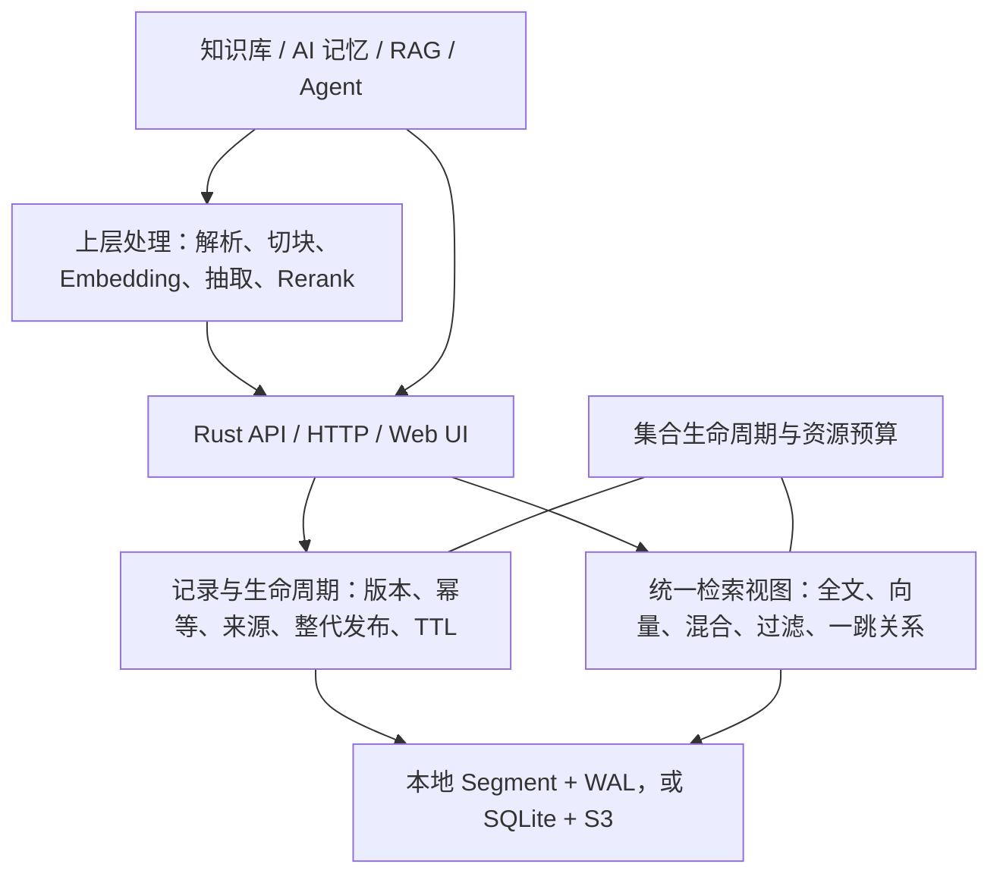

# 项目全貌与下一步建议

更新日期：2026-10-30。本文说明已合入 #90/#98/#102 后的能力与限制；合入和最终验收状态见 [STATUS](../STATUS.md)，后续建议见[路线](roadmap.md)。

## 定位与总体判断

anyseek 是面向 AI 记忆与知识的文档存储、检索底座，提供 Rust 核心库、HTTP API 和独立 Web 控制台。已经具备数据库主体能力：可靠记录、统一检索视图、生命周期、Tenant 隔离、持久化和恢复。当前最需要补齐的是长期运行、容量管理和运维验证。

应用负责文档解析、切块、Embedding、事实抽取、实体消歧、Rerank、模型推理和记忆归纳；anyseek 保存和检索准备好的记录、向量、来源及显式关系。不引入 SQL/JOIN、完整图查询语言或账户平台。

## 已实现的主体能力

| 层面 | 当前能力 | 使用边界 |
| --- | --- | --- |
| 检索 | BM25F 全文、IVF ANN、RRF 混合、多字段、中文、过滤、排序、分页、投影及逐命中解释 | ANN、有界融合及候选内字段重排不保证全库精确 Top-K |
| 可靠记录 | 稳定 ID、条件版本、墓碑、防 ABA、操作幂等和回执查询 | batch 为独立操作，不提供跨记录或跨 collection 原子事务 |
| 来源与证据 | 精确来源版本、字符/页码定位、直接和间接依赖、stale 与级联隐藏 | 来源和关系限定在同 collection；删除立即阻断内容输出 |
| 整文发布 | 多批私有 staging、租约、完整清单 Seal、整代 Publish 与清理 | staging 回执只证明持久，Publish 后成员才开放 |
| 向量后补 | 正文先可见，向量按精确版本后补 | 缺向量不参与该字段向量召回，不填零向量 |
| 时间与生命周期 | 固定 evaluation_time、时间过滤、不可逆 TTL | 过期结果持久化，不会因时钟回退复活 |
| 实体关系 | 显式实体目录、有预算的一跳邻居及关系通道融合 | 不自动抽取或推断关系，不提供完整图语言 |
| Tenant 认证 | API Key 绑定 Tenant，同租户 Key 访问范围一致，服务端验证集合归属 | master 仅做管理；凭据撤销只影响后续认证，不取消已认证工作 |
| 持久化 | 本地 WAL/发布见证/Segment，或 SQLite 协调与 S3 不可变对象 | 真实 S3 合同和系统断电尚未验收 |
| 备份恢复 | collection 快照、完整服务归档、独立恢复和安全对象 GC | 独立备份不能证明备份后没有删除；恢复不自动启用历史普通 Key |
| 服务资源 | 后台索引、校验缓存、collection 准入、控制预留及分级并发/字节/I/O 预算 | 保守准入与显式缓冲约束，不是全进程 RSS、系统带宽或全磁盘硬上限 |
| 接入 | Rust 库、HTTP、OpenAPI、Web UI、Python 工具及故障验收脚本 | UI 未覆盖全部管理操作，准确契约见服务指南 |

完整能力清单见 [FEATURES](../FEATURES.md)，请求示例和默认限制见[服务指南](../anyseek/src/server/README.md)。

## 存储与计算架构

默认服务为单机、多 collection；每个 collection 一个持久 partition。公开数据入口统一为 RecordPartition；内部多组件布局不代表分布式分片。

两种持久化模式共用 Record 语义、规范原始 Payload、不可变 Segment 和可变 tail。`/ingest` 持久提交后由全文与向量异步消费；查询固定派生读取拓扑和 evaluation_time，在 guard 外评分，再重验当前版本、删除及来源可见性。各消费者进度不要求一致。

| 模式 | 提交权威 | 内容存储与检索 | 恢复依据 |
| --- | --- | --- | --- |
| 本地 | 本地 PartitionJournal 的认证发布与提交见证 | 持久盘保存原始 Payload、Segment、检查点和 WAL；本机执行查询 | 认证检查点与完整已提交 tail；损坏时不静默回退旧状态 |
| S3 | 本地持久 SQLite，唯一选择 head、manifest 和提交/索引水位 | S3 保存不可变日志和文件块；本机缓存、物化 Segment 并执行查询 | SQLite 所选检查点及完整 tail，所有对象验证长度和 hash |

S3 写入按「登记上传身份 → 上传 → 远端读回校验 → SQLite 条件发布」推进，上传成功本身不代表提交；完整流程与失败边界见[存储协议](storage.md)。

S3 模式必须保留服务 catalog、SQLite 权威库及其 WAL；`collections/{tenant_id}/{collection_id}/{generation}` 内日志、Payload、索引和 `*.object-cache` 是可重建缓存。不能仅保留 bucket 或在运行中直接复制 SQLite 文件来代替共同备份。

后台 Indexer 已支持固定已提交 cut、屏障外构建、条件发布及保留期间新增 tail。当前仍是固定 cut 全量构建，自动增量调度未实现。协议细节见[存储文档](storage.md)。

## 直接影响使用的限制

| 限制 | 代码现状 | 影响 |
| --- | --- | --- |
| Record 身份 | 每 collection 最多 10,000，包含保留墓碑 | 删除不立即释放全部身份容量 |
| Record 操作账本 | 默认保留上限 10,000，已有按期限的 history trim | 窗口内历史仍占额度；旧请求由持久 epoch 和回收规则拒绝 |
| 内存与快照 | 完整逻辑 State 驻内存；状态、事件帧及分块 checkpoint 各有预算 | 分块不代表无限容量，S3 不等于超内存容量 |
| 缓存总量 | 每 authority 256 MiB / 4096 块，尚无全服务总额度 | 多个 authority 的占用可以累加 |
| 维护停顿 | 同步 compaction 保留 partition 串行屏障，部分控制和共同快照全局排空 | 不保证所有查询、维护、控制操作互不阻塞 |
| 部署 | SQLite 单主机、单持久卷、独占 owner | 不提供跨主机 HA、自动故障切换或权威卷丢失零 RPO |

现有 WAL/对象 GC、staging 清理、Record history trim 和 Catalog 过期回执整理已实现；已删除集合代次的最终物理回收由 #106 单独补齐。当前适合有界单机应用验证，不能承诺持续无限写入、长期稳定磁盘占用或任意容量。

## 后续工作与全文引擎

本轮优化、容量评估及外部验收的优先级和实施边界，具体完成标准统一见[路线](roadmap.md)，不在多份文档重复维护进度。

生产全文已使用 Tantivy 0.27.0 原生格式，保留原正式 BM25F/邻近度、分词和活动统计契约，向量与元数据独立。只面向新库，无迁移、双写或旧引擎兼容层。设计取舍见[Tantivy 设计](tantivy-evaluation.md)。
